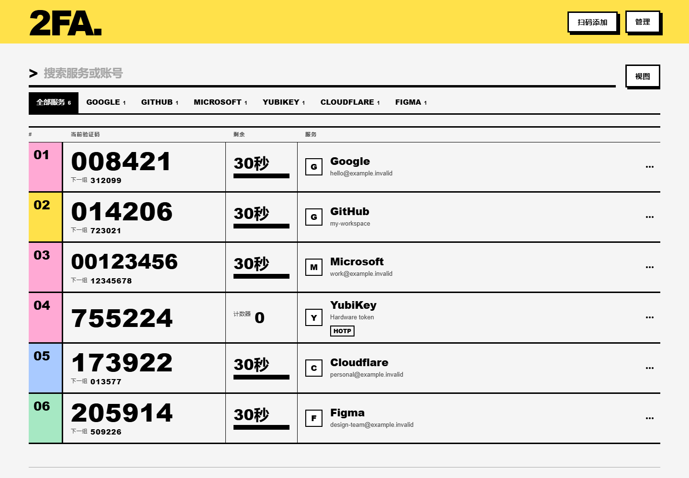

# Brutalist（野兽派）

这是 [wuzf/2fa](https://github.com/wuzf/2fa) 项目的主题，不能单独运行：需要先部署 2FA（2.0.0 或更高版本），再在 **设置 → 外观与主题 → 主题 → 社区主题** 中安装。

彩色野兽派 2FA 主题。明黄刊头、粗线分隔的账本行与巨大的验证码，服务用色块序号区分，搜索和服务页签滚动时吸顶。支持手机、深色模式及键盘操作。

版本 **1.0.0**，主题 ID `brutalist-for-2fa`，需要支持 Theme API 2 / SDK API 1 的 2FA。可与已有 Neubrutalism 主题同时安装。



[手机预览](docs/previews/mobile.png) · [深色预览](docs/previews/dark.png)

## 安装

自己构建时，先按下方「本地预览与构建」运行 `npm ci` 和 `npm run build`，再在 2FA 的 **设置 → 外观与主题 → 导入主题** 中选择 `dist/2fa-theme.zip`，预览后应用。

## 使用

- 点击大号验证码复制当前码，下方可复制下一码；HOTP 使用主机计数器与核对恢复流程。
- 搜索始终可见；**视图**中可筛选服务、排序、切换分组／平铺。
- **管理**提供添加账户、导入导出、备份、工具、偏好及安全恢复入口。
- 主题设置提供舒适／紧凑密度；账户多时选紧凑，一屏能多看约三成。语言、明暗跟随主机。
- 服务色块按服务标识固定（「其他服务」里的按服务名），筛选和排序不会重新分配颜色；颜色不承担状态含义。

## 本地预览与构建

```powershell
npm ci
npm run dev
```

打开 http://127.0.0.1:4223 。预览使用合成账户，主机表单显示说明窗口，不修改真实账户或写入真实剪贴板。

```powershell
npm run build
$env:HOST_ROOT = '../2fa'
npm test
npm run test:host
npm run format:check
```

构建支持 `node scripts/build.js --out-dir <目录>`，生成安装 ZIP、清单和 SHA-256。测试的临时文件写在当前进程的 `TEMP` / `TMP` 下，结束后会清理。安装包位于 `dist/`，开发壳和测试不会进入 ZIP。

所有运行资源均在包内；无外部字体、图片或 CDN 依赖。认证、验证码与数据操作使用主机 SDK。源码基于现有主题的 MIT 适配器，来源见 [NOTICE.md](NOTICE.md)。
